  

 

I'm a full-stack engineer in Thailand, currently at **GRAM Software Solution** building container and yard-operations software. Before that, at **AddTech Hub**, I owned payment-gateway and mobile value-added services that had to settle against real telecom networks: Go workers and schedulers on NSQ, MongoDB query work on live services, and SMS / USSD / IVR operator integrations. I started out as a research assistant at **NECTEC**.

Most of that work is private. This page shows the public side: small tools, a profiled performance fix, and how I work.

  
  
  
  
  
  
  
  
  
  

  
  

## Public projects

<table>
  <tr>
    <td width="50%" valign="top"></td>
    <td width="50%" valign="top"></td>
  </tr>
  <tr>
    <td width="50%" valign="top"></td>
    <td width="50%" valign="top"></td>
  </tr>
</table>

## Case study: a performance fix, measured first

**[toms-storage-search-cache](https://github.com/qaz74107410/toms-storage-search-cache)** is a Java client mod (Forge 1.20.1) for a storage-terminal search that froze on every keystroke in large modpacks.

- **Cause.** Each search rebuilt hundreds of item tooltips on the render thread, because the stock cache expired them after 5 seconds of inactivity.
- **Fix.** A mixin wraps those caches in longer-lived ones whose loader *is* the stock cache. Results stay identical; only the cache lifetime changes, and it is configurable back to stock.
- **Evidence.** Java Flight Recorder, about 4 s of continuous typing in a ~365-mod pack:

| Render-thread samples | Before | After |
| :--- | ---: | ---: |
| Search total | 175 | **43** |
| Tooltip building | 167 | **10** |

A second optimization (skipping an unchanged inventory snapshot) is shipped but marked *not yet tested in game* in the README rather than claimed.

## How I work

- **Measure before claiming.** Profiles and numbers first; untested work gets labelled as untested.
- **Keep the request thin.** Long-running work goes to a queue and a worker that can retry, not into the HTTP request.
- **Leave it operable.** Documented schemas, clear failure modes, and a deploy the next person can run.

 

<b>🎮 Just for fun: my last 12 months, played back</b> (click to open)

 

Every active day is an invader; the ship clears the wave, then a new one spawns tomorrow.

The same year as a city, one building per day:

Banner, language, project and shooter cards are generated from the GitHub API by scripts in <a href="./scripts"><code>scripts/</code></a> and refreshed daily by <a href="./.github/workflows/refresh-cards.yml">a workflow</a>.
