

  

 

<a href="#selected-work">SELECTED WORK</a> &nbsp;·&nbsp; <a href="#case-study--the-per-keystroke-freeze">CASE STUDIES</a> &nbsp;·&nbsp; <a href="#by-the-numbers">NUMBERS</a> &nbsp;·&nbsp; <a href="#how-i-work">HOW I WORK</a>

I build tools that **remove friction** — a mixin that stops a Minecraft terminal from freezing on every keystroke, a bot that answers game questions out of someone's own notebook instead of a bolted-on model, a scraper that keeps retrying until the slot actually opens.

Most of it is TypeScript and Python with a healthy amount of Java, and it usually ends up running on hardware I host myself.

  
  
  
  
  
  
  

## Selected work

<table>
  <tr>
    <td width="50%" valign="top"><a href="https://github.com/qaz74107410/toms-storage-search-cache">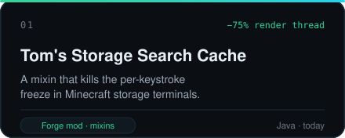</a></td>
    <td width="50%" valign="top"><a href="https://github.com/qaz74107410/phasmo-notebooklm-bot">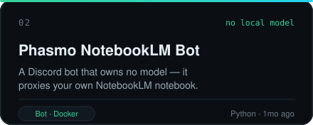</a></td>
  </tr>
  <tr>
    <td width="50%" valign="top"><a href="https://github.com/qaz74107410/fb-page-scraper">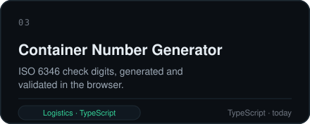</a></td>
    <td width="50%" valign="top"><a href="https://github.com/qaz74107410/my-jira-webui">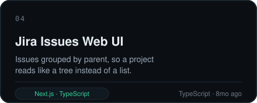</a></td>
  </tr>
  <tr>
    <td width="50%" valign="top"></td>
    <td width="50%" valign="top"><a href="https://github.com/qaz74107410/midi-flashcard-web">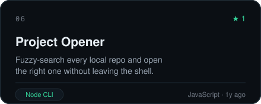</a></td>
  </tr>
  <tr>
    <td width="50%" valign="top"><a href="https://github.com/qaz74107410/random-container-no">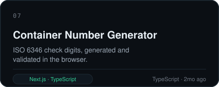</a></td>
    <td width="50%" valign="top"><a href="https://github.com/qaz74107410/watchtower-line-notifier">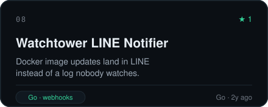</a></td>
  </tr>
</table>

> The top two are the ones worth reading closely — each was rebuilt around a bottleneck nobody had measured yet.

Also on GitHub: [cccregister](https://github.com/qaz74107410/cccregister) and a pile of older experiments from 2018–2022.

## Case study — the per-keystroke freeze

**[toms-storage-search-cache](https://github.com/qaz74107410/toms-storage-search-cache)** · Forge 1.20.1 client mod · Java · mixins · Apache-2.0

**The problem.** A terminal search with no prefix matches item names first. For every stored item whose name *doesn't* match, it then builds that item's full tooltip and matches against that — and building a tooltip fires `ItemTooltipEvent`, so every tooltip mod in the pack runs, on the render thread. Those tooltips sit in a Guava cache with `expireAfterAccess(5, SECONDS)`, so a keystroke after a short pause rebuilds hundreds of them at once. In a big pack that is a visible freeze on every character typed.

**The fix.** A mixin wraps the three search caches (`tooltipCache`, `nbtCache`, `tagCache`) in longer-lived caches whose loader *is* the stock cache. Tom's own code still computes every value, and the cache keys still include the item's NBT, so a changed item gets a fresh tooltip and search results are identical — only the cache lifetime moves. Configurable, with `5` restoring stock behaviour exactly.

**The second bottleneck, found while profiling.** EMI's craftables sidebar rebuilt a full player-inventory snapshot every 50 ms while a terminal was open — 80–100 ms of render thread per snapshot in a large network, against a list that Tom's only refreshes about every 500 ms. It is now skipped entirely when nothing changed (packet counter + stack fingerprint of the menu slots) and re-paced to 500 ms. Optional mixins: left out cleanly when EMI isn't installed.

**Measured, not asserted.** Java Flight Recorder, ~365-mod pack, render thread, ~4 s of continuous typing:

| | Before | After |
| :--- | ---: | ---: |
| Tom's search samples | 175 | **43** |
| of which tooltip building | 167 | **10** |

Honest caveat, straight from the README: *"EMI snapshot skipping: not yet tested in game."* It also ships a `build.sh` that compiles against an existing Forge install — no Gradle, no wrapper download.

## Case study — a bot that owns no model

**[phasmo-notebooklm-bot](https://github.com/qaz74107410/phasmo-notebooklm-bot)** · Python · Discord · Docker

Most "AI bot" projects re-implement retrieval badly. This one refuses to: it forwards plain channel messages to a **NotebookLM notebook you already filled with your own sources**, through `notebooklm-py`, and posts the answer back. No local vector store, no system prompt, no context juggling — the knowledge and the grounding stay where they were authored.

The interesting part is auth. NotebookLM has no API key, so a one-time `notebooklm login --browser-cookies chrome` harvests a real Chrome session, and the resulting `storage_state.json` is mounted into the container — the bot authenticates with **no browser on the server**. Cookie sessions expire, so the README says so plainly, tells you how to repeat the step, and warns to gitignore the auth directory and prefer a throwaway Google account.

## By the numbers

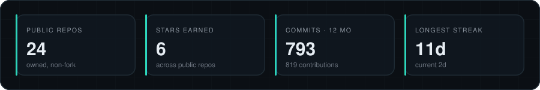

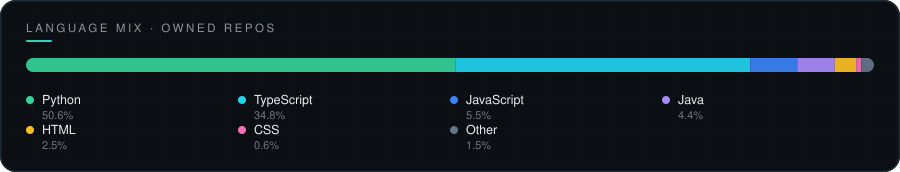

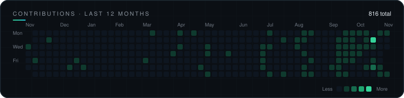

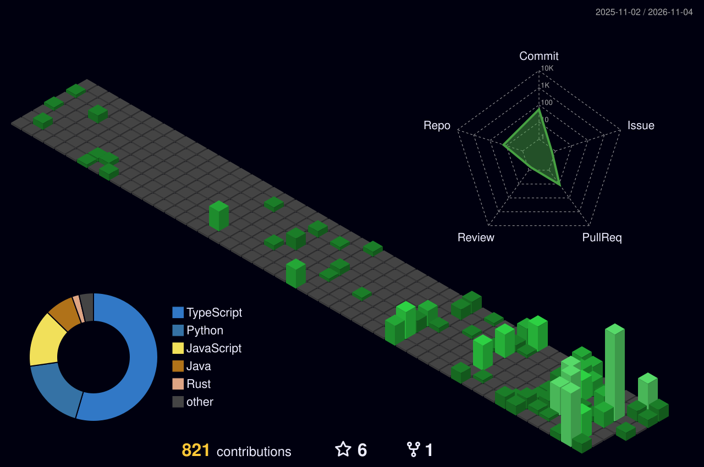

## How I work

- **Measure first, then claim.** The mod above started with a Flight Recorder profile, not a guess. Numbers that don't exist yet get written as "not yet tested" rather than rounded up.
- **Change the lifetime, not the behaviour.** The safest performance fix is usually the one that leaves every output identical — a longer cache, skipped no-op work, a tighter interval — not the one that rewrites the logic.
- **Own the deploy.** Docker, Postgres, Cloudflare Tunnel, systemd and a Raspberry Pi that never sleeps: I run the things I build, which is why the failure modes in my READMEs are the real ones.

## Currently

- Building **agent infrastructure** — runtimes, workflows and dashboards that let coding agents do real work unattended.
- Self-hosting the whole stack, from reverse proxy to database, on one Pi.
- Rebuilding open-source editors in **Rust** to learn how the tool actually works.

 

Banner, stat, language, heatmap and project cards are generated from the GitHub API by <a href="./scripts/gen_cards.py"><code>gen_cards.py</code></a> and <a href="./scripts/gen_projects.py"><code>gen_projects.py</code></a>, refreshed daily by <a href="./.github/workflows/refresh-cards.yml">a workflow</a> — no third-party image services, so they don't break when someone else's rate limit does.
