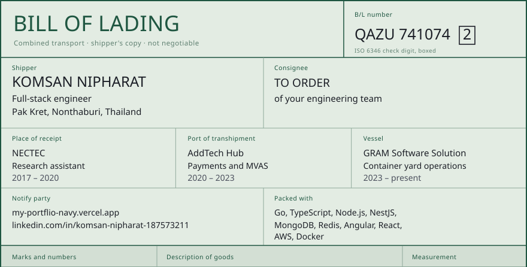
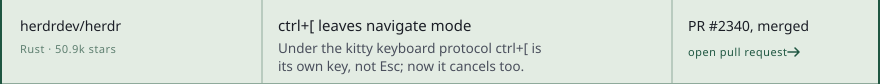
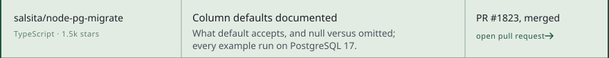
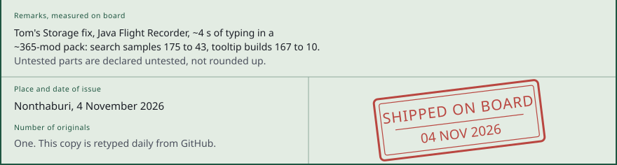

<a href="https://my-portflio-navy.vercel.app"><picture><source media="(prefers-color-scheme: dark)" srcset="./assets/bl-head-dark.svg"></picture></a> <a href="https://github.com/qaz74107410/toms-storage-search-cache"><picture><source media="(prefers-color-scheme: dark)" srcset="./assets/bl-goods-1-dark.svg"></picture></a> <a href="https://github.com/qaz74107410/my-jira-webui"><picture><source media="(prefers-color-scheme: dark)" srcset="./assets/bl-goods-2-dark.svg"></picture></a> <a href="https://github.com/qaz74107410/random-container-no"><picture><source media="(prefers-color-scheme: dark)" srcset="./assets/bl-goods-3-dark.svg"></picture></a> <a href="https://github.com/qaz74107410/phasmo-notebooklm-bot"><picture><source media="(prefers-color-scheme: dark)" srcset="./assets/bl-goods-4-dark.svg"></picture></a> <picture><source media="(prefers-color-scheme: dark)" srcset="./assets/bl-stc-dark.svg"></picture> <picture><source media="(prefers-color-scheme: dark)" srcset="./assets/bl-tranship-dark.svg"></picture> <a href="https://github.com/herdrdev/herdr/pull/2340"><picture><source media="(prefers-color-scheme: dark)" srcset="./assets/bl-tranship-1-dark.svg"></picture></a> <a href="https://github.com/AltanS/collie/pull/93"><picture><source media="(prefers-color-scheme: dark)" srcset="./assets/bl-tranship-2-dark.svg"></picture></a> <a href="https://github.com/salsita/node-pg-migrate/pull/1823"><picture><source media="(prefers-color-scheme: dark)" srcset="./assets/bl-tranship-3-dark.svg"></picture></a> <a href="https://github.com/jemishavasoya/dev-cleaner/pull/43"><picture><source media="(prefers-color-scheme: dark)" srcset="./assets/bl-tranship-4-dark.svg"></picture></a> <picture><source media="(prefers-color-scheme: dark)" srcset="./assets/bl-foot-dark.svg"></picture>

Most of my work ships in private repositories: payment and telecom services at AddTech Hub, container-yard software at GRAM. The cargo above is the public part, plus fixes merged into other people's projects. Each line opens its repository or pull request.

**How I work.** I measure before I claim anything, and label untested work as untested. Long-running jobs go to a queue and a worker that can retry, not into the HTTP request. I leave behind documented schemas and a deploy the next person can run.

[Portfolio and CV](https://my-portflio-navy.vercel.app) · [LinkedIn](https://www.linkedin.com/in/komsan-nipharat-187573211)

<picture><source media="(prefers-color-scheme: dark)" srcset="./assets/shooter-dark.svg"></picture>

Every sheet is generated from the GitHub API by <a href="./scripts"><code>scripts/</code></a> and retyped daily by <a href="./.github/workflows/refresh-cards.yml">a workflow</a>. Set in Archivo and Courier Prime, both under the <a href="./fonts">SIL Open Font License</a>.
